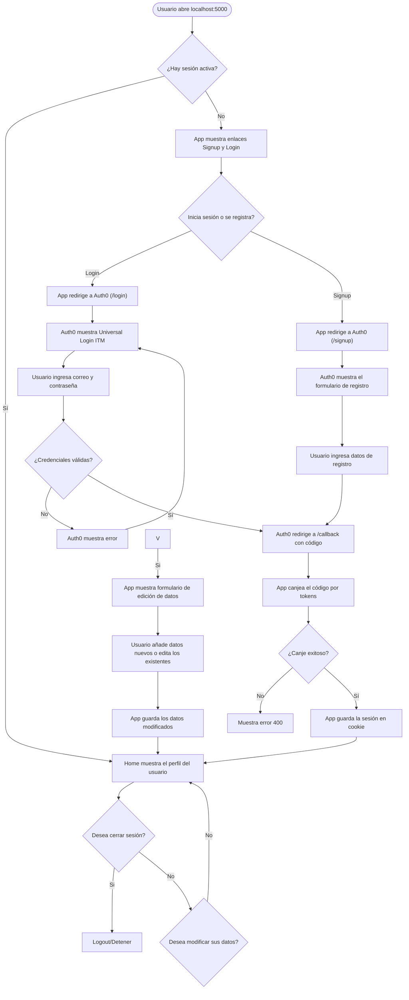

# Auth0-itm-guia3
Taller Guía 3 - Aplicaciones y servicios web (Auth0)
Yulieth Muñoz y Cristobal Mejia

Este es el repositorio de código donde se trabajó el versionamiento del aplicativo realizado para el Taller 3. Se usó Python y se manejó toda la implementación, permisos y personalización desde la interfaz de administración del tenant en la página de Auth0, ambos en el equipo team-0f7sg34

## Diagrama de flujo

